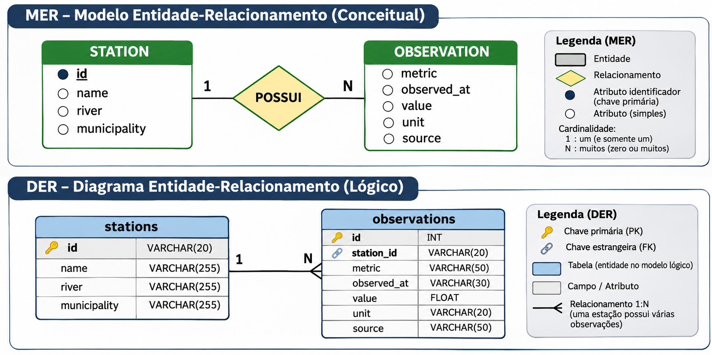

# Arquitetura

## Stack

| Componente | Versão | Papel |
|---|---|---|
| Python | 3.12+ | Linguagem |
| Django | 6.1.2 | Framework web e ORM |
| Django REST Framework | 3.18.3 | Endpoints REST, serialização, autenticação |
| django-filter | 26.2 | Filtros por query string |
| drf-spectacular | 0.30.0 | Schema OpenAPI, Swagger UI e ReDoc |
| SQLite | — | Banco de desenvolvimento (`db.sqlite3`) |

## Estrutura de pastas

```
.
├── manage.py                   # utilitário de linha de comando do Django
├── BancoDeDados.py             # popula o banco com dados simulados
├── requirements.txt
├── docs/                       # esta documentação
├── monitoramentohidrologico/   # projeto Django
│   ├── settings.py             # apps, DRF, autenticação, banco, Swagger
│   ├── urls.py                 # roteamento de todas as URLs
│   ├── wsgi.py / asgi.py       # pontos de entrada para servidores
└── monitoramento/              # app principal
    ├── models.py               # Station e Observation
    ├── serializers.py          # conversão modelo <-> JSON
    ├── views.py                # ViewSets e as ações summary/series
    ├── admin.py                # telas do painel /admin/
    └── tests.py                # (ainda sem testes)
```

## Fluxo de uma requisição

```
Cliente HTTP
   │
   ▼
urls.py ──► DefaultRouter ──► StationViewSet / ObservationViewSet
                                   │
                                   ├─ autenticação (Token ou Sessão)
                                   ├─ permissão (IsAuthenticatedOrReadOnly)
                                   ├─ filtros (DjangoFilterBackend)
                                   ├─ serializer (validação e JSON)
                                   ▼
                              models.py ──► SQLite
```

O `DefaultRouter` (em `monitoramentohidrologico/urls.py`) gera as rotas de CRUD a partir de cada `ModelViewSet`:

```python
router.register(r'stations', StationViewSet)
router.register(r'observations', ObservationViewSet)
```

As ações `summary` e `series` são criadas com `@action(detail=True, methods=['get'])` dentro de `StationViewSet`. O nome da função vira o final da URL: `/api/stations/{id}/summary/` e `/api/stations/{id}/series/`.

## Modelo de dados

![MER e DER do Monitoramento Hidrológico]

### `Station` (tabela `stations`)

| Campo | Tipo | Obrigatório | Descrição |
|---|---|---|---|
| `id` | texto, até 20 caracteres | Sim | Chave primária. Código da estação, informado pelo cliente (ex.: `EST-01`) |
| `name` | texto, até 255 | Sim | Nome da estação |
| `river` | texto, até 255 | Sim | Rio monitorado |
| `municipality` | texto, até 255 | Sim | Município |

### `Observation` (tabela `observations`)

| Campo | Tipo | Obrigatório | Descrição |
|---|---|---|---|
| `id` | inteiro | Gerado | Chave primária autoincremental |
| `station` | código da estação | Sim | Estação da leitura. Na tabela, a coluna é `station_id` |
| `metric` | texto, até 50 | Sim | `level` (nível do rio) ou `rain` (chuva) |
| `observed_at` | texto, até 30 | Sim | Data/hora da leitura em ISO 8601 UTC (`2026-11-17T10:00:00.000Z`) |
| `value` | número real | Sim | Valor medido |
| `unit` | texto, até 20 | Sim | `m` para `level`, `mm/h` para `rain` |
| `source` | texto, até 50 | Sim | Origem do dado (ex.: `synthetic`, `manual`) |

Regras:

- Não pode haver duas observações com a mesma combinação de `station`, `metric` e `observed_at`.
- Ao remover uma estação, as observações dela são removidas junto (`on_delete=CASCADE`).
- `observed_at` é guardado como **texto**, não como data. Ordenação e comparação funcionam porque todas as datas seguem o mesmo formato. Veja [limitacoes.md](limitacoes.md).
- Os nomes das tabelas (`stations`, `observations`) são os mesmos usados por `BancoDeDados.py`.

### Métricas

| `metric` | `unit` | Significado |
|---|---|---|
| `level` | `m` | Nível do rio, em metros |
| `rain` | `mm/h` | Chuva, em milímetros por hora |

O modelo aceita qualquer texto em `metric` e `unit`. Os valores acima são a convenção usada pelos dados e pelas ações `summary` e `series`.

## Configuração (`settings.py`)

### Django REST Framework

```python
REST_FRAMEWORK = {
    'DEFAULT_AUTHENTICATION_CLASSES': [
        'rest_framework.authentication.TokenAuthentication',
        'rest_framework.authentication.SessionAuthentication',
    ],
    'DEFAULT_PERMISSION_CLASSES': [
        'rest_framework.permissions.IsAuthenticatedOrReadOnly',
    ],
    'DEFAULT_FILTER_BACKENDS': [
        'django_filters.rest_framework.DjangoFilterBackend',
    ],
    'DEFAULT_SCHEMA_CLASS': 'drf_spectacular.openapi.AutoSchema',
}
```

- **Autenticação:** token no cabeçalho `Authorization` ou sessão do Django (login pelo `/admin/`).
- **Permissão:** leitura pública, escrita só para usuários autenticados.
- **Paginação:** nenhuma configurada.

### Documentação OpenAPI

`SPECTACULAR_SETTINGS` define título, descrição e versão (`1.0.0`) do schema. O ReDoc é carregado do CDN jsDelivr (`redoc@2.1.5`).

### Ambiente

| Configuração | Valor atual | Observação |
|---|---|---|
| `DEBUG` | `True` | Só para desenvolvimento |
| `SECRET_KEY` | fixa no código | Trocar e ler de variável de ambiente em produção |
| `ALLOWED_HOSTS` | `[]` | Aceita só `localhost`/`127.0.0.1` enquanto `DEBUG=True` |
| `TIME_ZONE` | `UTC` | |
| Banco | `BASE_DIR / 'db.sqlite3'` | |

## Painel administrativo (`/admin/`)

Registrado em `monitoramento/admin.py`:

| Modelo | Colunas | Busca | Filtros laterais |
|---|---|---|---|
| Station | name, river, municipality | name, river, municipality | name, river, municipality |
| Observation | station_id, metric, observed_at, value, unit, source | station_id, metric | station_id, metric, observed_at, unit |

Os tokens de API também aparecem no admin, registrados pelo app `rest_framework.authtoken`.
